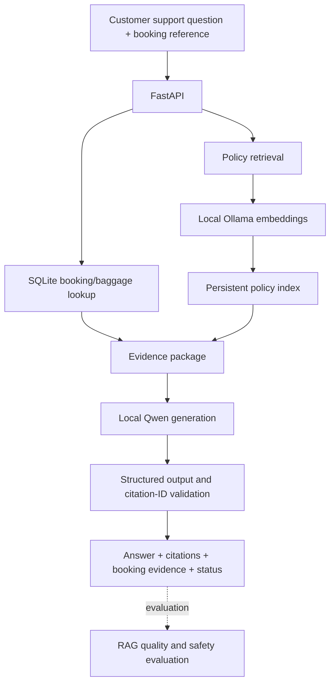

# ResolveAI

**Evidence-grounded airline support investigations with FastAPI, local LLMs, and RAG evaluation.**

> **Status: Work in progress.** Core investigation, semantic retrieval, and local LLM answer-generation components have been implemented. RAG answer-quality evaluation and deployment readiness are next.

ResolveAI is a portfolio-oriented AI engineering project built around a **fictional airline, Northstar Air**. It combines structured booking and baggage records with airline policy retrieval to answer support questions using inspectable evidence.

The central engineering question is:

**Can an AI support assistant provide useful answers without inventing facts that the underlying records do not establish?**

## What it does

- Looks up bookings and associated baggage records in SQLite.
- Searches policy sections with keyword retrieval, semantic embeddings, or experimental hybrid ranking.
- Reuses a local policy embedding index and rebuilds it when the policy changes.
- Retrieves policy evidence for a customer question.
- Uses a local Qwen model to draft an answer from booking data and retrieved policy sections.
- Returns an answer, policy citation IDs, booking evidence, and an answer/insufficient-evidence status.
- Validates the structure of generated output and rejects nonexistent citation IDs.
- Exposes the workflow as documented FastAPI endpoints.

**Important limitation:** Valid citation IDs and a well-formed response do **not** establish factual faithfulness. Claim-level support, hallucination rates, and adversarial robustness are being evaluated separately. This is a research/learning prototype, not a production airline service.

## System architecture



## Technology stack

| Layer | Technology |
| --- | --- |
| API and validation | Python 3.10, FastAPI, Pydantic |
| Structured data | SQLite |
| Policy search | Keyword retrieval, cosine similarity, experimental reciprocal rank fusion (RRF) |
| Embeddings | Ollama, `qwen3-embedding:4b` |
| Answer generation | Ollama chat API, `qwen3.5:35b-mlx` |
| Testing | pytest, FastAPI TestClient |
| Evaluation | Retrieval ranking metrics; answer-quality framework in progress |

The generation model name reflects the current developer's local Ollama environment; availability may differ on other machines.

## API endpoints

| Method | Route | Description |
| --- | --- | --- |
| `GET` | `/` | Basic welcome response |
| `GET` | `/bookings/{booking_reference}/baggage` | Booking and baggage lookup |
| `GET` | `/policies/search` | Keyword policy search |
| `POST` | `/investigations` | Structured investigation with keyword policy evidence |
| `POST` | `/investigations/semantic` | Investigation with ranked semantic policy evidence |
| `POST` | `/investigations/answer` | Evidence retrieval plus local LLM answer generation |

Interactive API documentation is available at `http://127.0.0.1:8000/docs` while the server runs.

### Example: grounded answer request

```json
{
  "booking_reference": "YOUR_EXISTING_BOOKING_REFERENCE",
  "question": "What does the policy say about reporting delayed baggage?",
  "top_k": 3
}
```

`POST /investigations/answer` returns the model's answer, `answered` or `insufficient_evidence` status, citation IDs, retrieved policy sections, booking data, and retrieval/index metadata. Use a booking reference that exists in the local database.

## Running locally

### Prerequisites

- Python 3.10 and a virtual environment
- Ollama running locally on `http://localhost:11434`
- Installed local embedding and generation models
- A populated SQLite database at `data/database/northstar.db`
- The configured Northstar Air policy document and policy retrieval source module

```bash
git clone https://github.com/cynos1/resolveai.git
cd resolveai

python3.10 -m venv .venv
source .venv/bin/activate
python -m pip install -r requirements.txt

ollama list
python -m pytest tests/ -v
python -m uvicorn src.main:app --reload
```

**Reproducibility note:** The repository is still being prepared for a clean, from-scratch setup. The local SQLite `.db` file is excluded from version control. At the time of this README, `src/policy_retrieval.py` is referenced by the application but is not present on the GitHub default branch. Database initialization, sample fixtures, and the missing source file must be added before a fresh clone will run end to end. The commands above describe the intended local workflow, not a verified one-command installation.

## Testing and evaluation

```bash
python -m pytest tests/ -v
```

Previous local experiments compared keyword, semantic, and hybrid retrieval using Hit@K and mean reciprocal rank (MRR). Semantic retrieval was selected as the primary approach for the investigation endpoint; hybrid retrieval remains available for comparison.

The evaluation program is expanding to cover:

- Factual claims supported by booking or policy evidence
- Citation validity **versus** genuine citation support
- Appropriate abstention when records do not contain an answer
- Unsupported baggage locations, delivery promises, or payment approvals
- Prompt injection and adversarial user/policy content
- Reproducible regression reports and documented failure cases

## Development roadmap

| Phase | Milestones | Status |
| --- | --- | --- |
| Backend and data foundations | 1–5: ingestion, SQLite, FastAPI, retrieval, investigation | Completed locally |
| RAG retrieval engineering | 6–10: ranking evaluation, embeddings, hybrid comparison, persistent index, semantic API | Completed locally |
| Local grounded generation | 11: Qwen generation, structured output, citation-ID validation | Completed locally |
| RAG answer evaluation | 12: dataset, deterministic checks, reports | In progress |
| Faithfulness and safety | 13–14: claim-level checks, hallucinations, adversarial robustness | Planned |
| Delivery and portfolio | 15–16: Docker/CI/observability, documentation, demo, reproducibility | Planned |

See commit history for incremental implementation work. Roadmap completion indicates implementation progress, **not** certification of production reliability.

## Design principles

1. **Evidence before generation:** Retrieve booking and policy context before requesting an answer.
2. **Expose uncertainty:** A model should not imply it knows the live location of baggage unless that fact is actually present in records.
3. **Keep retrieval measurable:** Compare search approaches using a fixed evaluation set.
4. **Separate validity from truth:** JSON schema and citation-ID checks are necessary but insufficient.
5. **Build reproducibly:** Add tests, record evaluation failures, document limits, and improve deployment support.

## Project purpose

ResolveAI is a hands-on demonstration of backend/API engineering, retrieval-augmented generation, local model integration, testable orchestration, and responsible AI evaluation. It uses simulated airline support scenarios and is **not affiliated with an actual airline**.

---

*The README is intentionally versioned alongside the code and will be updated as evaluation, deployment, and reproducibility milestones are completed.*
